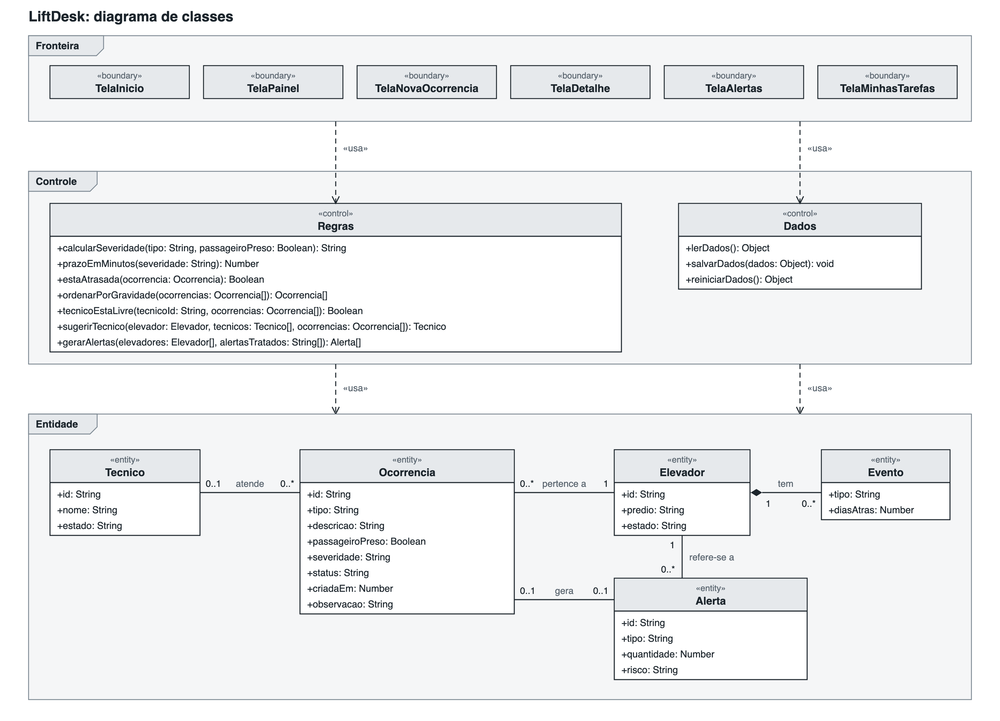
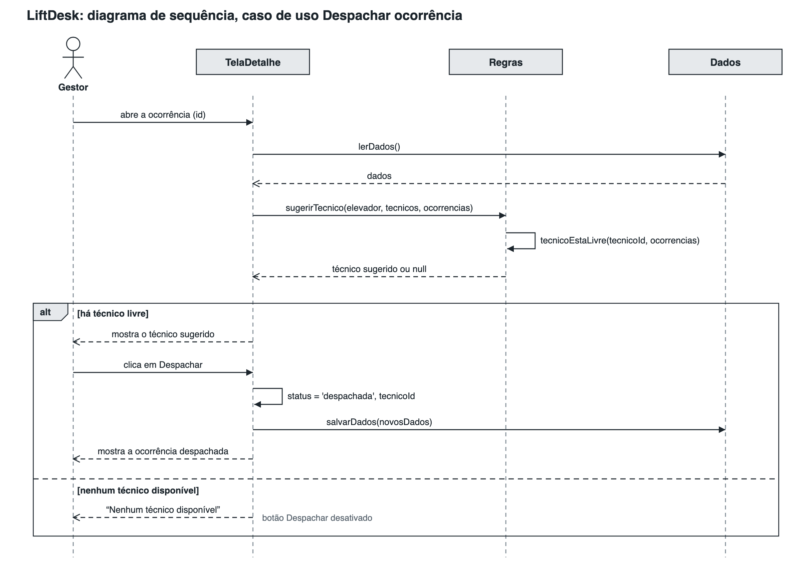

# LiftDesk

Gestão de ocorrências de elevadores — Challenge OTIS · FIAP Engenharia de Software 2026 (Sprint 2).

- **Começando agora? Leia primeiro: [docs/COMO-COMECAR.md](docs/COMO-COMECAR.md)**
- O que vamos construir: [docs/superpowers/specs/2026-10-12-liftdesk-mvp-design.md](docs/superpowers/specs/2026-10-12-liftdesk-mvp-design.md)
- Plano e divisão de tarefas: [docs/superpowers/plans/2026-10-12-liftdesk-mvp.md](docs/superpowers/plans/2026-10-12-liftdesk-mvp.md)
- Melhorias com a Fase 7: [docs/superpowers/plans/2026-10-17-liftdesk-fase7-melhorias.md](docs/superpowers/plans/2026-10-17-liftdesk-fase7-melhorias.md)

Grupo: Lucas, Pietro, Erick e João Victor.

## Documentação

- [Roteiro do vídeo](docs/roteiro-video.md)
- [Backlog com MoSCoW](docs/backlog.md)

### Diagrama de classes

### Diagrama de sequência: Despachar ocorrência

